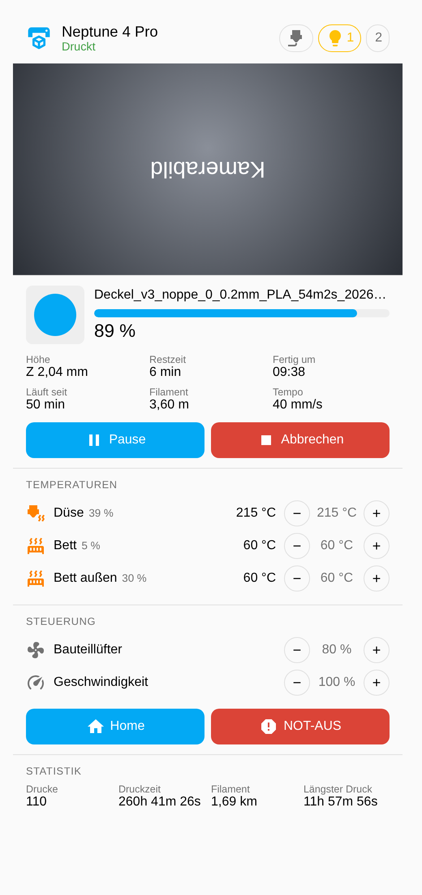

# Moonraker Printer Card

**Deutsch** | [English](#english)

Eine Lovelace-Karte für Klipper-Drucker, die über die
[Moonraker-Integration](https://github.com/marcolivierarsenault/moonraker-home-assistant)
in Home Assistant eingebunden sind. Im visuellen Editor wählst du nur das
Drucker-Gerät aus, die Karte findet alle Entitäten selbst.



Entstanden für einen Elegoo Neptune 4 Pro, funktioniert aber mit jedem Drucker,
den die Moonraker-Integration anlegt.

## Funktionen

- Status, Lichtschalter (`output_pin …light…`) und Filamentsensor im Kopf
- Kamera live oder als Standbild, **drehbar (0/90/180/270°) und spiegelbar**, ohne card-mod
- Laufender Druck: Vorschaubild, Fortschrittsbalken, Datei, Schicht *x / y*
  (oder Z-Höhe, wenn der Slicer keine Schichtinfo liefert), Restzeit, Fertig-um-Uhrzeit,
  Laufzeit, Filamentverbrauch, Geschwindigkeit
- Pause / Fortsetzen / Abbrechen (mit Rückfrage)
- Alle Heizungen mit Ist-, Sollwert und Leistung; Sollwert per −/+ in 5-°C-Schritten,
  Antippen öffnet den genauen Regler. Mehrere Bettzonen (z. B. `heater_bed1`) und Extruder werden erkannt.
- Bauteillüfter, Geschwindigkeitsfaktor, Home, Not-Aus (mit Rückfrage)
- Statistik: Anzahl Drucke, Gesamtdruckzeit, Filament, längster Druck
- Deutsch und Englisch, folgt dem HA-Theme (hell/dunkel)

## Installation

### HACS (benutzerdefiniertes Repository)

1. HACS → ⋮ → *Benutzerdefinierte Repositories* → `https://github.com/bggsolar/ha-moonraker-printer-card`, Typ **Dashboard**.
2. *Moonraker Printer Card* herunterladen und den Browser neu laden.

### Manuell

`moonraker-printer-card.js` nach `/config/www/` kopieren und unter
*Einstellungen → Dashboards → ⋮ → Ressourcen* als `/local/moonraker-printer-card.js`
(Typ *JavaScript-Modul*) hinzufügen.

## Konfiguration

Karte hinzufügen → *Moonraker Printer Card* und den Drucker auswählen. Oder in YAML:

```yaml
type: custom:moonraker-printer-card
device_id: 0123456789abcdef   # Drucker-Gerät aus der Moonraker-Integration
camera_rotation: 180
```

| Option | Standard | Beschreibung |
|---|---|---|
| `device_id` | – | Moonraker-Gerät (im Editor auswählbar) |
| `prefix` | – | Alternativ: Entitäts-Präfix, z. B. `hobbyraum_neptune_4_pro` |
| `name` | Gerätename | Überschrift |
| `camera` | automatisch | Kamera-Entität fest vorgeben (empfohlen, wenn der Drucker mehrere Kamera-Entitäten hat) |
| `camera_rotation` | `0` | `0`, `90`, `180` oder `270` |
| `camera_mirror` | `false` | Bild horizontal spiegeln |
| `camera_live` | `true` | Live-Video statt Standbilder. Liefert die Kamera keinen Stream, schaltet die Karte automatisch auf Standbilder um. |
| `camera_refresh` | `2` | Standbild-Intervall in Sekunden |
| `show_camera` | `true` | Kamera anzeigen |
| `show_temperatures` | `true` | Temperaturen anzeigen |
| `show_controls` | `true` | Lüfter, Geschwindigkeit, Home, Not-Aus anzeigen |
| `show_stats` | `true` | Statistik anzeigen |

### Schichtanzeige mit OrcaSlicer

Viele Klipper-Firmwares bekommen die Schichtzahl nur, wenn der Slicer sie meldet.
In OrcaSlicer unter *Druckereinstellungen → Machine G-code*:

- Ende des Start-G-Codes: `SET_PRINT_STATS_INFO TOTAL_LAYER=[total_layer_count]`
- Layer change G-code: `SET_PRINT_STATS_INFO CURRENT_LAYER={layer_num + 1}`

Ohne diese Angaben zeigt die Karte die aktuelle Z-Höhe.

---

## English

A Lovelace card for Klipper printers connected through the
[Moonraker integration](https://github.com/marcolivierarsenault/moonraker-home-assistant).
Pick the printer device in the visual editor; the card finds all entities by itself.

Features: status, lights and filament sensor; camera (live or snapshots) that can be
**rotated and mirrored without card-mod**; running job with thumbnail, progress, layer
(or Z height), time left, finish time, elapsed time, filament and speed; pause / resume /
cancel; all heaters (multiple bed zones and extruders) with target −/+; part fan,
speed factor, home, emergency stop; statistics. German and English.

Install through HACS as a custom repository of type **Dashboard**, or copy
`moonraker-printer-card.js` to `/config/www/` and add it as a resource.
Options: see the table above.

## Releases

Neue Versionen entstehen automatisch: `CARD_VERSION` in `moonraker-printer-card.js` erhöhen, per Pull Request mergen, der Workflow *Release* legt das GitHub-Release `vX.Y.Z` an. HACS meldet es dann als Update.

## License

MIT, see [LICENSE](LICENSE). Not affiliated with Klipper, Moonraker or any printer vendor.
